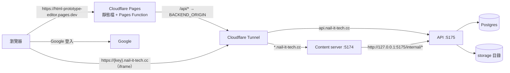

# 部署：Cloudflare Pages（前端）＋自己的機器（後端）＋ Google 登入

## 拓撲



| 網域 | 用途 |
|---|---|
| `html-prototype-editor.pages.dev` | 主應用。`/api/*` 由 Pages Function（`apps/web/functions/api/[[path]].ts`）代理到後端，所以瀏覽器只看到這一個 origin，session cookie 是第一方 |
| `api.nail-it-tech.cc` | 後端 API，只給 Pages Function 呼叫 |
| `{contentKey}.nail-it-tech.cc` | prototype 內容（設計 D1：獨立於主應用的網域）。`CONTENT_BASE_DOMAIN=nail-it-tech.cc` |

content 網域必須是**單層**子網域（`{key}.nail-it-tech.cc`）：Cloudflare 免費的 Universal SSL 只涵蓋 `*.nail-it-tech.cc` 這一層。

## 1. 後端機器（Mac mini）

前置：Node ≥ 22、pnpm、Postgres（本機或 `docker compose up -d`）、`cloudflared`。

```bash
git clone … && cd html-prototype-editor
pnpm install && pnpm build     # frame-agent / export-viewer 的產物是執行時需要的
```

在 repo 根目錄建立 `.env`（不要 commit）：

```ini
NODE_ENV=production
APP_ORIGIN=https://html-prototype-editor.pages.dev
# 使用者的瀏覽器看到的 API 位址（含 /api 前綴）；Google redirect URI 與 OAuth cookie Path 由它推導
API_ORIGIN=https://html-prototype-editor.pages.dev/api
# content server → API 的內部通道，走本機，不經公網
API_INTERNAL_ORIGIN=http://127.0.0.1:5175
CONTENT_BASE_DOMAIN=nail-it-tech.cc
TRUST_PROXY=true

DATABASE_URL=postgres://localhost:5432/hpe
STORAGE_DRIVER=fs
STORAGE_FS_ROOT=.data/storage

SESSION_SECRET=<至少 32 字元的隨機字串>
INTERNAL_TOKEN=<隨機字串>
GOOGLE_CLIENT_ID=…
GOOGLE_CLIENT_SECRET=…
# 不要設 DEV_LOGIN：NODE_ENV=production 時設了會直接啟動失敗
```

啟動（API 與 content 預設只監聽 127.0.0.1，由 Tunnel 連入，不對區網開放）：

```bash
pnpm db:migrate
pnpm --filter @hpe/api start      # :5175
pnpm --filter @hpe/content start  # :5174
```

要常駐、開機自動啟動、當機重啟，可用 pm2：`pm2 start "pnpm --filter @hpe/api start" --name hpe-api`（content 同理），再 `pm2 startup && pm2 save`。

## 2. Cloudflare Tunnel

`nail-it-tech.cc` 的 DNS 要在 Cloudflare。

```bash
cloudflared tunnel login
cloudflared tunnel create hpe
cloudflared tunnel route dns hpe api.nail-it-tech.cc
cloudflared tunnel route dns hpe "*.nail-it-tech.cc"
```

`~/.cloudflared/config.yml`（規則由上到下比對，`api.` 要寫在 wildcard 之前）：

```yaml
tunnel: <TUNNEL_ID>
credentials-file: /Users/<you>/.cloudflared/<TUNNEL_ID>.json
ingress:
  # /internal/* 只給 content server 經 127.0.0.1 使用，不從公網進來
  - hostname: api.nail-it-tech.cc
    path: ^/internal/
    service: http_status:404
  - hostname: api.nail-it-tech.cc
    service: http://127.0.0.1:5175
  - hostname: "*.nail-it-tech.cc"
    service: http://127.0.0.1:5174
  - service: http_status:404
```

執行 `cloudflared tunnel run hpe`（或 `cloudflared service install` 開機常駐）。

## 3. Google OAuth client

Google Cloud Console → APIs & Services → Credentials → OAuth client ID → **Web application**：

- **Authorized redirect URI**：`https://html-prototype-editor.pages.dev/api/auth/google/callback`
- Authorized JavaScript origins：不需要（走 server-side code flow）

OAuth consent screen 在測試期維持 **Testing**，把測試者的 Gmail 加進 Test users（最多 100 人）：沒被加入的帳號 Google 會直接擋下，等於一份免費的邀請名單。公開前再切到 In production。

## 4. Cloudflare Pages

```bash
# 一次性：Pages 專案的後端位址（Pages 專案 → Settings → Variables 也可以設）
wrangler pages secret put BACKEND_ORIGIN --project-name html-prototype-editor   # 填 https://api.nail-it-tech.cc

# 每次部署
pnpm deploy:web
```

`deploy:web` 會以 `VITE_API_ORIGIN=/api`、`VITE_CONTENT_BASE_DOMAIN=nail-it-tech.cc` 建置，並在 `apps/web` 目錄執行 `wrangler pages deploy`（Pages Function 才會被打包）。建置時會一併產生 `_headers`（CSP：`frame-src https://*.nail-it-tech.cc`、`connect-src 'self'`）。

## 5. 驗證

```bash
curl -i https://html-prototype-editor.pages.dev/api/me
# → 401 {"error":{"code":"UNAUTHENTICATED",…}}   （代理與後端都通）
curl -i https://html-prototype-editor.pages.dev/api/auth/google
# → 302 location: https://accounts.google.com/…，set-cookie: hpe_oauth=…; Path=/api/auth/google
curl -i https://html-prototype-editor.pages.dev/api/internal/content/x
# → 404（代理不轉發 /internal）
```

再用瀏覽器開 `https://html-prototype-editor.pages.dev/projects`，應被導到 `/login`；點「使用 Google 登入」→ 選帳號 → 回到 `/projects`。上傳一個 HTML，確認預覽 iframe 載入 `https://{key}.nail-it-tech.cc/`。

## 已知限制

- 限流依 `X-Forwarded-For` 最左邊的 IP。經 Pages Function 的請求，Function 會用 `cf-connecting-ip` 覆寫它；但直接打 `api.nail-it-tech.cc` 的人可以偽造這個標頭而繞過限流。測試期可接受；要補強可讓 Function 加一個共用 secret 標頭、API 端只信任帶有它的請求。
- 後端機器關機或斷網時整個服務不可用；`.data/storage` 與 Postgres 需自行備份。
- Cloudflare Tunnel 的 wildcard 路由、Universal SSL 涵蓋範圍是依官方文件規則設定，首次部署請照第 5 節實測。
